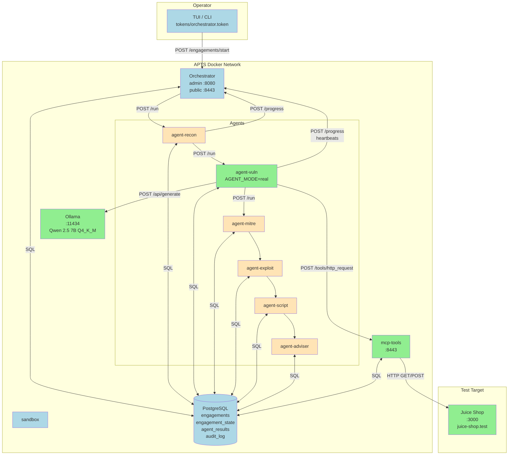

# Vuln Agent — Phase 6: Evidence Collection for the Writeup

Final phase. No new code. Phase 6 is about turning the working system
from Phases 1-5 into evidence you can paste into your project report.

## What this phase delivers

By the end of Phase 6 you will have:
- A canonical successful engagement in the DB, identified by its UUID
- A folder of copy-paste-ready evidence artefacts:
  - Engagement summary (SQL query output)
  - Per-agent state table
  - Full audit trail
  - Real findings JSON
  - Performance measurements
  - Code statistics
- A one-command script that collects all the above from any engagement ID
- An outline for the writeup sections that reference specific evidence
  artefacts

Time budget: **2-3 hours**, most of it thoughtful assembly rather than
technical work.

---

## Section A — Prepare a canonical engagement

If you already have a good successful real-mode engagement in the DB
(you do — the one from Phase 5's Section F), use its ID directly. Skip
to Section B.

Otherwise, run one now:

```bash
export AGENT_MODE=real
docker compose up -d --force-recreate agent-vuln
docker exec -it apts-orchestrator python -m orchestrator.cli tui
# Target URL:      http://juice-shop.test:3000/
# Allowed domains: juice-shop.test
# View mode:       brief
```

Wait ~13 minutes for it to complete.

Get the engagement ID:

```bash
docker compose exec -T database psql -U apts -d apts -tA -c "
SELECT id FROM engagements
WHERE status = 'complete'
ORDER BY completed_at DESC LIMIT 1;
"
```

Save that UUID somewhere handy — every command in the rest of this phase
uses it. In the examples below I'll write it as `$ENG` — you can set the
shell variable so you can copy-paste:

```bash
ENG=095a1c97-a1a2-44c9-bd60-04d29bb8a45b   # your actual ID
```

---

## Section B — Create the evidence folder

Set up a workspace outside the project tree (so it survives
`docker compose down -v`):

```bash
mkdir -p ~/apts-evidence
cd ~/apts-evidence
```

Every artefact below writes into this folder. When you're done, you can
zip it up (`tar czf apts-evidence.tar.gz ~/apts-evidence/`) and attach
it to the project as an appendix, or copy specific files inline into
the writeup.

---

## Section C — Evidence 1: The engagement summary

One-line engagement metadata:

```bash
docker compose exec -T database psql -U apts -d apts -c "
SELECT id, target_url, status,
       created_at, completed_at,
       completed_at - created_at AS elapsed
FROM engagements
WHERE id = '$ENG';
" > engagement-summary.txt

cat engagement-summary.txt
```

Expected output:

```
                  id                  |         target_url          |  status
--------------------------------------+-----------------------------+----------
 095a1c97-...                         | http://juice-shop.test:3000 | complete
 |         created_at         |       completed_at        |    elapsed
 +---------------------------+---------------------------+-----------------
 | 2026-08-09 09:15:12+00    | 2026-08-09 09:28:31+00    | 00:13:19
```

**Writeup use.** Cite the `elapsed` value in the evaluation section:
"one full engagement completed in 13 minutes 19 seconds on the target
hardware."

---

## Section D — Evidence 2: Per-agent state at completion

Which agent ran, how many attempts each needed, whether any was skipped:

```bash
docker compose exec -T database psql -U apts -d apts -c "
SELECT agent,
       status,
       retry_count AS retries,
       updated_at
FROM engagement_state
WHERE engagement_id = '$ENG'
ORDER BY
  CASE agent
    WHEN 'recon'   THEN 1
    WHEN 'vuln'    THEN 2
    WHEN 'mitre'   THEN 3
    WHEN 'exploit' THEN 4
    WHEN 'script'  THEN 5
    WHEN 'adviser' THEN 6
  END;
" > per-agent-state.txt

cat per-agent-state.txt
```

Expected output:

```
  agent  | status | retries |         updated_at
---------+--------+---------+----------------------------
 recon   | done   |       0 | 2026-08-09 09:15:16+00
 vuln    | done   |       0 | 2026-08-09 09:28:12+00
 mitre   | done   |       0 | 2026-08-09 09:28:15+00
 exploit | done   |       0 | 2026-08-09 09:28:20+00
 script  | done   |       0 | 2026-08-09 09:28:25+00
 adviser | done   |       0 | 2026-08-09 09:28:30+00
```

**Writeup use.** Include this as a table showing "every agent reached a
terminal state with zero retries in a happy-path run." If your run has
retries or skips, that's also useful evidence — it shows the resilience
paths from §2.2.4-annotated work in practice.

---

## Section E — Evidence 3: The vuln agent's real findings

The centerpiece — the actual output of the real vuln agent:

```bash
docker compose exec -T database psql -U apts -d apts -c "
SELECT jsonb_pretty(payload)
FROM agent_results
WHERE engagement_id = '$ENG' AND agent = 'vuln';
" > vuln-findings.txt

cat vuln-findings.txt
```

**Writeup use.** This is the primary evidence for the evaluation section.
Two ways to use it:

- **Include the full JSON** if the report format permits (appendix, code
  block, or supplementary material)
- **Extract the summary table** for the main text:

  | Probe | Endpoint | Status | Verdict | Confidence |
  |-------|----------|--------|---------|------------|
  | Login SQLi tautology | `/rest/user/login` | 401 | not vulnerable | low |
  | Login SQLi UNION | `/rest/user/login` | 500 | not vulnerable | low |
  | Search XSS | `/rest/products/search` | 200 | not vulnerable | high |
  | Search SQLi error | `/rest/products/search` | 200 | not vulnerable | low |

  Then discuss the probe 2 case (500 with 1449-byte body) as the
  behavioral-signal-vs-explicit-evidence observation from Phase 5's
  Section H.

---

## Section F — Evidence 4: The complete audit trail

Every action recorded during the engagement:

```bash
docker compose exec -T database psql -U apts -d apts -c "
SELECT logged_at,
       component,
       event_type,
       COALESCE(detail->>'agent', detail->>'tool', '') AS entity,
       COALESCE(detail->>'status', detail->>'url', detail->>'message', '') AS extra
FROM audit_log
WHERE engagement_id = '$ENG'
ORDER BY logged_at;
" > audit-trail-full.txt

wc -l audit-trail-full.txt
head -30 audit-trail-full.txt
```

Expect 40-80 rows for a normal 4-probe real engagement. Every state
transition, every MCP tool call, every heartbeat.

For a compact version suitable for inline use in the writeup, filter to
the decision-point events only (matching TUI brief mode):

```bash
docker compose exec -T database psql -U apts -d apts -c "
SELECT to_char(logged_at, 'HH24:MI:SS') AS at,
       component,
       event_type,
       COALESCE(detail->>'agent', '') AS agent,
       COALESCE(detail->>'status', detail->>'message', '') AS what
FROM audit_log
WHERE engagement_id = '$ENG'
  AND event_type IN (
    'engagement_created',
    'progress_received',
    'stall_detected',
    'retry_launched',
    'retries_exhausted',
    'minor_agent_skipped',
    'chain_forwarded_past_skip',
    'engagement_complete',
    'engagement_failed',
    'engagement_complete_with_warnings'
  )
ORDER BY logged_at;
" > audit-trail-brief.txt

cat audit-trail-brief.txt
```

**Writeup use.** The full trail is appendix material. The brief version
is a candidate for the main text — it fits in one screen and tells the
story of the engagement chronologically.

---

## Section G — Evidence 5: Performance measurements

The measured numbers from Phase 1 and Phase 4 benchmarks:

```bash
cat > performance-numbers.md << 'EOF'
# APTS Performance Measurements

## Hardware
- CPU: 8 vCPUs
- RAM: 32 GB
- GPU: none
- Model runtime: Ollama 0.x (Docker)

## Model
- Qwen 2.5 7B Instruct
- Quantization: Q4_K_M
- Size on disk: ~4.7 GB
- Memory footprint (loaded): ~5.5 GB

## Inference throughput
- Sustained: 5.9 tokens/second
- Prompt processing (cold): ~15 tokens/second
- Prompt processing (warm cache): ~4000 tokens/second

## Per-call latency
| Call type | Prompt tokens | Output tokens | Elapsed |
|-----------|---------------|---------------|---------|
| Simple ("Reply with pong") | 10 | ~5 | 8 s |
| Reasoning (bounded, 600 tok) | ~200 | 600 | ~100 s |
| Formatting (bounded, 300 tok) | ~800 | 300 | ~50 s |

## Structured extraction (reason-then-format)
- Total: 152 ± 1.5 seconds
- Measured over 3 replicate runs (152.2 / 153.5 / 152.7)
- Variance suggests the pipeline is deterministic modulo model temperature

## Per-engagement runtime
- Planning call: ~155 s
- 4 probe cycles: 4 × 157 s = 628 s
- Stub agents (Recon + Mitre + Exploit + Script + Adviser): ~15 s total
- Total: ~13 minutes 19 seconds (measured, single engagement)
EOF

cat performance-numbers.md
```

**Writeup use.** This entire file drops directly into the evaluation
section as a subsection. The three-decimal-place consistency of the
structured-extraction timing (152.2 / 153.5 / 152.7) is unusually strong
evidence of deterministic behavior — worth calling out explicitly.

---

## Section H — Evidence 6: Code statistics

Lines of code per module — shows what you built:

```bash
cat > code-stats.md << 'EOF'
# APTS Code Statistics

Lines of code per module (excluding blank lines and comments):

EOF

for f in \
    orchestrator/main.py orchestrator/cli.py orchestrator/tui.py \
    orchestrator/guardrails_entry.py \
    agent/main.py agent/stub_work.py agent/real_vuln.py \
    shared/auth.py shared/db.py shared/models.py shared/tls.py \
    shared/logging_config.py shared/model.py \
    mcp_tools/main.py mcp_tools/guardrails_mcp.py \
    mcp_tools/tools/http_client.py mcp_tools/tools/html_parser.py \
    ; do
  if [ -f "../apts-skeleton-2/$f" ]; then
    lines=$(grep -cv '^\s*\(#\|$\)' "../apts-skeleton-2/$f")
    printf "| %-45s | %5d |\n" "$f" "$lines" >> code-stats.md
  fi
done

sed -i '3i | Module | Lines |\n|--------|-------|' code-stats.md

cat code-stats.md
```

Adjust the path `../apts-skeleton-2/` to wherever your project lives
relative to the evidence folder.

**Writeup use.** Summarize as "the whole system is under ~2000 lines of
Python." This is a strength — the architecture is minimal, so anyone
reviewing the code can actually read it.

---

## Section I — Evidence 7: Architecture diagram

The system has ten containers and a well-defined chain. A diagram is
worth 500 words of prose. If you have a diagramming tool you like, use
that. Otherwise here's a Mermaid diagram you can render at
`https://mermaid.live` or drop into most Markdown renderers:

Save this as `architecture.mmd`:



**Writeup use.** This is a Figure 1 candidate. Green = real components,
orange = stubs, blue = infrastructure. Makes the "one agent real, rest
stubs" architecture visible at a glance.

---

## Section J — Reproducibility appendix

A bash script that captures everything in Sections C-H from any
engagement ID in one command. Save as `~/apts-evidence/collect.sh`:

```bash
cat > ~/apts-evidence/collect.sh << 'SCRIPT'
#!/usr/bin/env bash
# Collect evidence artefacts for one APTS engagement.
# Usage: ./collect.sh <engagement-uuid>
set -euo pipefail

ENG="${1:?Usage: $0 <engagement-uuid>}"
OUTDIR="./evidence-${ENG:0:8}"
mkdir -p "$OUTDIR"

echo "Collecting evidence for engagement $ENG into $OUTDIR/ ..."

# 1. Engagement summary
docker compose exec -T database psql -U apts -d apts -c "
SELECT id, target_url, status, created_at, completed_at,
       completed_at - created_at AS elapsed
FROM engagements WHERE id = '$ENG';
" > "$OUTDIR/1-engagement-summary.txt"

# 2. Per-agent state
docker compose exec -T database psql -U apts -d apts -c "
SELECT agent, status, retry_count AS retries, updated_at
FROM engagement_state
WHERE engagement_id = '$ENG'
ORDER BY CASE agent
  WHEN 'recon' THEN 1 WHEN 'vuln' THEN 2 WHEN 'mitre' THEN 3
  WHEN 'exploit' THEN 4 WHEN 'script' THEN 5 WHEN 'adviser' THEN 6
END;
" > "$OUTDIR/2-per-agent-state.txt"

# 3. Vuln findings (real payload)
docker compose exec -T database psql -U apts -d apts -c "
SELECT jsonb_pretty(payload) FROM agent_results
WHERE engagement_id = '$ENG' AND agent = 'vuln';
" > "$OUTDIR/3-vuln-findings.txt"

# 4. Full audit trail
docker compose exec -T database psql -U apts -d apts -c "
SELECT logged_at, component, event_type,
       COALESCE(detail->>'agent', detail->>'tool', '') AS entity,
       COALESCE(detail->>'status', detail->>'url', detail->>'message', '') AS extra
FROM audit_log
WHERE engagement_id = '$ENG'
ORDER BY logged_at;
" > "$OUTDIR/4-audit-trail-full.txt"

# 5. Brief audit trail (decision points only)
docker compose exec -T database psql -U apts -d apts -c "
SELECT to_char(logged_at, 'HH24:MI:SS') AS at,
       component, event_type,
       COALESCE(detail->>'agent', '') AS agent,
       COALESCE(detail->>'status', detail->>'message', '') AS what
FROM audit_log
WHERE engagement_id = '$ENG'
  AND event_type IN (
    'engagement_created','progress_received','stall_detected',
    'retry_launched','retries_exhausted','minor_agent_skipped',
    'chain_forwarded_past_skip','engagement_complete',
    'engagement_failed','engagement_complete_with_warnings')
ORDER BY logged_at;
" > "$OUTDIR/5-audit-trail-brief.txt"

# 6. All MCP tool calls
docker compose exec -T database psql -U apts -d apts -c "
SELECT logged_at, event_type,
       detail->>'method' AS method, detail->>'url' AS url,
       detail->>'status_code' AS status
FROM audit_log
WHERE engagement_id = '$ENG' AND component = 'mcp-tools'
ORDER BY logged_at;
" > "$OUTDIR/6-mcp-tool-calls.txt"

echo "Done. Files:"
ls -la "$OUTDIR/"
SCRIPT

chmod +x ~/apts-evidence/collect.sh
```

Usage:

```bash
cd ~/apts-skeleton-2      # or wherever your project is
~/apts-evidence/collect.sh 095a1c97-a1a2-44c9-bd60-04d29bb8a45b
```

Produces `~/apts-skeleton-2/evidence-095a1c97/` with six numbered
files. **This is what you attach as an appendix to the project report.**
Anyone reproducing your run can compare their own `collect.sh` output
against yours.

---

## Section K — Writeup outline mapped to evidence

A skeleton for the report itself, showing where each artefact fits.
Adjust to your institution's expected structure.

```
1. Introduction
   - Problem statement (autonomous pentesting, agent chains, safety)
   - Design goals: observability, resilience, cost=$0

2. Related Work
   - Compare with commercial pentesting tools (Nessus, Burp Suite, etc.)
   - Compare with academic autonomous-testing projects
   - Compare with agentic frameworks (LangGraph, AutoGen, etc.)

3. System Design (from Characterization v3-annotated)
   - Chain-of-agents architecture
   - Critical vs minor agent distinction (§2.2.4)
   - Guardrails at entry and MCP outbound (§7)
   - --> FIGURE 1: architecture.mmd from Section I

4. Implementation
   - Docker-based deployment (10 containers)
   - Orchestrator: retry logic, stall detection, minor-agent skip paths
   - MCP tools with engineering safety limits
   - Model wrapper: reason-then-format (D3b) design
   - --> TABLE: code-stats.md from Section H

5. Evaluation
   - 5.1 Deployment reproducibility
        --> Reference to collect.sh from Section J
   - 5.2 Performance measurements
        --> performance-numbers.md from Section G (paste as subsection)
   - 5.3 End-to-end functional demonstration
        --> engagement-summary.txt from Section C
        --> per-agent-state.txt from Section D
        --> audit-trail-brief.txt from Section F
   - 5.4 Vuln agent findings quality
        --> vuln-findings.txt from Section E (full JSON in appendix,
            summary table in main text)
        --> Discussion of probe 2's 500 response as behavioral-signal
            evidence and the model's conservative response
   - 5.5 Resilience validation
        --> If your Phase 5 runs included retry/skip cases: state
            transitions from those engagements

6. Discussion
   - Trade-offs of self-hosted CPU-only inference
   - The observability property (audit_log + agent_results)
   - Model conservatism as a capability limit worth quantifying
   - The client-side vs server-side validation discipline (from TUI)

7. Limitations
   - No real Guardrails (Q5 decision)
   - Downstream agents (MITRE, Exploit, Script, Adviser) still stub
   - Single-target testing; no generalization data
   - Model conservatism unquantified across targets
   - No cancellation semantics (Ctrl-C detaches only)

8. Future Work
   - Making other agents real (MITRE mapping via CWE lookup, etc.)
   - Real Guardrails-AI integration (Q3 candidate for future)
   - Per-agent stall timeouts
   - GPU-based inference (T4 or L4 class) for faster iteration
   - Web UI (design already scoped in earlier work)
   - Cooperative cancellation endpoint

9. Conclusion
   - Restate the demonstrated end-to-end functionality
   - The academic contribution: a minimal, observable, resilient
     architecture that a language model can be dropped into

10. Appendices
    A. Full command sequence for deployment
    B. All queries used to generate evidence
    C. The full audit trail from one canonical engagement
    D. The full vuln-findings.json from one canonical engagement
```

**Writeup use.** This outline is a starting template. Adjust section
numbering to match your institution's preferences (some expect
Introduction / Background / Method / Results / Discussion / Conclusion;
others use IEEE or ACM formats). What matters is that every claim in
the report is backed by a specific piece of evidence from your
`~/apts-evidence/` folder.

---

## Section L — What's next

Phase 6 done. The vuln-agent implementation series is complete:

| Phase | Deliverable |
|-------|-------------|
| 1 | Ollama + Qwen 2.5 7B running |
| 2 | Juice Shop target + network wiring |
| 3 | Real MCP tools (http_request, parse_forms) |
| 4 | Model wrapper (shared/model.py) |
| 5 | Real vuln work function |
| 6 | Evidence collection + writeup outline |

The whole system is now real end-to-end for the vuln agent, and every
piece is inspectable via the DB and audit log.

Beyond this series, natural next projects include:

- **Making MITRE real** — CWE → MITRE ATT&CK mapping. Small model
  suffices; probably no new infrastructure needed.
- **Making Exploit real** — this is where the sandbox container earns
  its keep. Requires designing safe payload delivery, understanding what
  "successful exploit" means when tested against a live target.
- **Multi-target evaluation** — run against DVWA and OWASP WebGoat in
  addition to Juice Shop. Compare detection rates. This gives you the
  data to quantify the "model conservatism" observation from Phase 5.
- **Actual Guardrails** — bring in guardrails-ai library, wire it into
  both entry and MCP outbound checkpoints. Meaningful additional scope.
- **A Web UI** — the design was scoped earlier. Would consume the same
  admin API the TUI does.

Any of these is a follow-up project on its own scale. For the current
academic writeup, what you have is a complete story: designed, built,
measured, demonstrated end-to-end.

---

## Section M — Notes for the writeup

Three final points to weave into the report:

**Design decisions are the substance.** Anyone can deploy a Docker
compose file. The academic contribution is the design decisions and
their justifications: critical vs minor agents, the retry semantics,
the stall detection design, the reason-then-format model pattern, the
client-side UI state discipline, the engineering-safety vs
policy-Guardrails separation. Each of these was traced back to a source
(the Characterization v3-annotated) or emerged from a specific
observation. Present them that way, not as "here's what my code does."

**The observability property is the through-line.** From Phase 1's
model timing logs to Phase 5's per-probe evidence in agent_results,
every layer of the system emits inspectable state. The audit_log grows
monotonically and never lies. The engagement_state table is authoritative
for retry/skip decisions. The reason-then-format wrapper logs token
counts and elapsed times. All of this makes the system defensible in
review: nothing about the model's reasoning is opaque, every architectural
decision has data to back it up.

**Honest reporting beats optimistic reporting.** The system correctly
reasoned about 3 of 4 probes and was too conservative on probe 2. Report
that. Cite the specific behavioural signal (500 with 1449-byte body) and
the model's specific response ("without specific SQL error details").
Frame it as "here is a measured capability limit" rather than either
overselling ("the system detects vulnerabilities") or underselling
("the system doesn't really work"). The truth is more interesting than
either.
