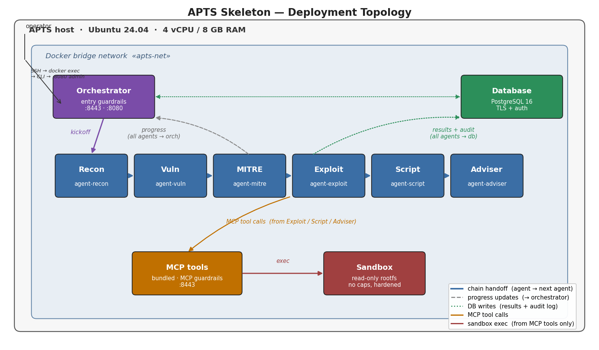

# APTS Skeleton

Deployment infrastructure for the **Autonomous Penetration Testing System** —
a chain of six working agents plus an orchestrator, backed by a central
database and reached only through a controlled MCP surface. This repository
is the **skeleton**: every container, every secure channel, every DB write,
and every retry path is real, but each agent's actual work is a stub that
sleeps briefly and returns a canned result. Swapping the stubs for real
model calls is a follow-up step that touches only `agent/stub_work.py` and
`mcp_tools/main.py` — the deployment, transport, and control-plane
infrastructure does not change.

The design matches Characterization v3 §1.2 (chain-of-agents with central
database) and §7 (Guardrails at exactly two checkpoints).



---

## Contents

1. [Prerequisites](#prerequisites)
2. [Bring-up runbook](#bring-up-runbook)
3. [Resource sizing](#resource-sizing)
4. [Directory layout](#directory-layout)
5. [What is stubbed vs. real](#what-is-stubbed-vs-real)
6. [Design notes](#design-notes)
7. [Troubleshooting](#troubleshooting)
8. [Next steps](#next-steps)

---

## Prerequisites

* Linux host (Ubuntu 24.04 LTS recommended; anything with a modern kernel works)
* Docker Engine 24+ and Docker Compose v2
* `openssl` and `python3` on the host (only for the bootstrap step)
* Practice targets on a **separate VM**, reachable from the APTS host

Everything runs as an unprivileged Docker user; `sudo` on the host is only
needed to install Docker and open outbound firewall rules to the target VM.

---

## Bring-up runbook

### 1. Configure

```bash
cp .env.example .env
$EDITOR .env         # set APTS_DB_PASSWORD to a long random string
```

Keep `APTS_TARGET_ALLOWLIST` empty for a first smoke test; the entry
Guardrails will accept any target. Populate it before pointing this at
anything real.

### 2. Generate certificates

```bash
./bootstrap/generate_certs.sh
```

Produces `./certs/<component>.key`, `./certs/<component>.crt`, and
`./certs/trust-bundle.pem`. Each certificate has a SAN entry matching the
Docker service name (`orchestrator`, `agent-recon`, and so on) so TLS
verification works across the internal bridge network. Certificates are
valid for 397 days.

### 3. Start the database

```bash
# Write the DB password into the docker-secrets file
mkdir -p tokens && chmod 700 tokens
grep '^APTS_DB_PASSWORD=' .env | cut -d= -f2- > tokens/db_password.txt
chmod 600 tokens/db_password.txt

docker compose up -d database
docker compose logs -f database   # wait for "database system is ready to accept connections"
```

The schema in `bootstrap/init_db.sql` is loaded automatically on first
start (via the Postgres image's `docker-entrypoint-initdb.d` hook).

### 4. Generate tokens and seed hashes

```bash
./bootstrap/generate_tokens.py
```

Writes ten raw-token files under `./tokens/`, upserts a salted SHA-256 of
each into the `token_hashes` table. The raw tokens are needed by the
container that owns them (mounted read-only as `/run/secrets/token`) and
by nobody else.

### 5. Bring up the rest of the stack

```bash
docker compose up -d
docker compose ps          # every service should show state 'running' / 'healthy'
```

Idle memory usage should sit around **1.1–1.4 GB**; idle CPU near zero.

### 6. Start an engagement

```bash
docker exec -it apts-orchestrator python -m orchestrator.cli start \
    --target=https://juice-shop.test/ \
    --domain='*.juice-shop.test'
# → prints engagement_id: 6b4c...
```

### 7. Watch progress

```bash
docker exec -it apts-orchestrator python -m orchestrator.cli watch 6b4c...

# example output:
# [   recon]  started
# [   recon]  done
# [    vuln]  started
# [    vuln]  done
# [   mitre]  started
# [   mitre]  done
# [ exploit]  started
# [ exploit]  done
# [  script]  started
# [  script]  done
# [ adviser]  started
# [ adviser]  done
#
# == engagement complete ==
```

Total runtime is ~20 seconds because the stub delays sum to about that.

### 8. Inspect the DB

```bash
docker exec -it apts-database psql -U apts -d apts \
    -c "SELECT agent, written_at FROM agent_results WHERE engagement_id = '6b4c...';"

docker exec -it apts-database psql -U apts -d apts \
    -c "SELECT component, event_type, logged_at FROM audit_log
        WHERE engagement_id = '6b4c...' ORDER BY logged_at;"
```

You should see one `agent_results` row per agent and a dense audit trail
covering every kickoff, handoff, and progress update.

### 9. Test the retry path

```bash
# Give every agent a 30 % chance of failing at startup
echo 'APTS_STUB_FAILURE_RATE=0.3' >> .env
docker compose up -d --force-recreate agent-recon agent-vuln agent-mitre \
    agent-exploit agent-script agent-adviser

docker exec -it apts-orchestrator python -m orchestrator.cli start \
    --target=https://juice-shop.test/ --domain='*.juice-shop.test'
```

Watching the engagement should now show occasional `failed → started` cycles
as the orchestrator re-launches an agent from the previous stage's DB record.

---

## Resource sizing

Idle, on a 4 vCPU / 8 GB host:

| container         | RAM (idle) | CPU (idle) | Notes                       |
| ----------------- | ---------: | ---------: | --------------------------- |
| database          |    ~180 MB |       ~0 % | PostgreSQL 16 default tune  |
| orchestrator      |    ~120 MB |       ~0 % | Two uvicorn workers         |
| agent-recon…6×    |     ~90 MB |       ~0 % | Same image, different cmd   |
| mcp-tools         |    ~100 MB |       ~0 % |                             |
| sandbox           |     ~70 MB |       ~0 % | Read-only rootfs            |
| **total**         | **~1.1 GB** |            |                            |

Compose sets hard `deploy.resources.limits` on every service so a leaking
process cannot starve the host: 256 MB per agent, 512 MB for the DB, 128 MB
for the sandbox. Under load (during an engagement) memory climbs only
slightly for the skeleton because the "work" is a `sleep`. When real models
land, the agent limits will need to grow — see [Next steps](#next-steps).

**Disk**: base images ~500 MB total, code negligible, DB grows with audit
log at ~1 KB per event. Plan for 5–10 GB free.

---

## Directory layout

```
.
├── README.md
├── docker-compose.yml       # 10 services, one bridge network, per-container secrets
├── Dockerfile               # one image, used by orchestrator/agents/mcp-tools/sandbox
├── requirements.txt         # pinned Python deps (fastapi, uvicorn, httpx, psycopg, pydantic)
├── .env.example             # copy to .env, set APTS_DB_PASSWORD
├── .gitignore               # never commit .env, certs/, or tokens/
│
├── bootstrap/
│   ├── init_db.sql          # schema: engagements, agent_results, audit_log,
│   │                        #         token_hashes, engagement_state
│   ├── generate_certs.sh    # self-signed cert per component + trust bundle
│   └── generate_tokens.py   # raw tokens → tokens/, hashes → DB
│
├── shared/                  # imported by every Python service
│   ├── auth.py              # bearer-token parse / verify / require_*
│   ├── db.py                # short-lived psycopg connections + audit()
│   ├── tls.py               # server + client SSL contexts
│   ├── logging_config.py
│   └── models.py            # Pydantic wire types (ChainHandoff, ProgressUpdate, ...)
│
├── orchestrator/
│   ├── main.py              # dual uvicorn (public 8443 + admin 8080 loopback)
│   ├── cli.py               # operator CLI (start / status / watch)
│   └── guardrails_entry.py  # embedded entry checkpoint (Characterization §7.1)
│
├── agent/
│   ├── main.py              # same code for all six agents; AGENT_NAME env picks role
│   └── stub_work.py         # canned per-agent output; replace when models arrive
│
├── mcp_tools/
│   ├── main.py              # /tool/{scanner,http,cve,attack_kb,sandbox,report}
│   └── guardrails_mcp.py    # embedded MCP outbound checkpoint (§7.2)
│
├── sandbox/
│   └── main.py              # /exec stub that never actually runs commands
│
├── docs/
│   └── deployment.png       # topology diagram
│
├── certs/                   # generated; git-ignored
└── tokens/                  # generated; git-ignored
```

---

## What is stubbed vs. real

**Real** (production-quality in this skeleton):

* Docker Compose topology, network, secrets, resource limits.
* TLS on every internal connection, verified against the trust bundle.
* Bearer-token authentication on every HTTP request, verified against
  salted SHA-256 hashes stored in Postgres.
* Component-restricted endpoints: `/progress` accepts only `agent-*`, the
  sandbox `/exec` accepts only `mcp-tools`, and so on.
* Chain-of-agents handoff, DB writes, audit log, per-agent state tracking,
  three-retry logic that pulls the previous stage's output from the DB.
* Critical / minor agent distinction from Characterization §2.2.4 —
  critical agents (recon, vuln, exploit) stop the engagement after three
  failed retries; minor agents let the chain continue.

**Stubbed** (to be replaced during the modelling phase):

* Each agent's `do_stub_work` returns a canned result of the right shape.
* Entry Guardrails is a placeholder: allowlist + a hard-coded prompt
  injection regex, not the real `guardrails-ai` library.
* MCP outbound Guardrails is similarly a placeholder: scope check + a
  short destructive-command denylist.
* MCP tool endpoints (`scanner`, `http`, `cve`, `attack_kb`, `report`)
  return canned data; only `sandbox` actually forwards to another container.
* Sandbox `/exec` acknowledges the command but does not execute it.

---

## Design notes

### Why does the DB have its own password?

Every HTTP-level component authenticates with a bearer token verified
against the `token_hashes` table. The database is different: PostgreSQL's
own auth layer runs *before* any application logic could check a bearer
token, so it needs its own credential. We give it a strong random password
mounted from Docker secrets and use `sslmode=verify-full` so every
component still gets end-to-end TLS to the DB. The bearer-token model still
covers everything above the SQL socket.

### Why not full mTLS?

TLS clients verify server certs against the trust bundle, but clients
present bearer tokens rather than client certs. This keeps cert management
tractable (one cert per component, self-signed) and puts caller identity
in the token — which we need in the database anyway for the audit log.
A future hardening step is to also require client certs for defense in
depth.

### Why a single Docker image?

Orchestrator, six agents, MCP tools, and sandbox all run the same base
Python plus the same shared modules. Building one `apts-skeleton:latest`
and selecting a role via `command:` keeps the build time short, the layer
cache useful, and the deployment simpler to reason about. If a service
grows dependencies the others don't need (a heavy scanner in mcp-tools,
say), split its Dockerfile out then.

### Why `python:3.11-slim-bookworm`?

Python 3.11 has a full year more ecosystem maturity than 3.12 — every
library we care about has had time to publish wheels and fix rough edges
on it. Bookworm is Debian 12, currently the LTS release; security updates
are supported until around 2028. Pinning to the specific base tag means
`docker build` on a fresh host in a year gives the same image (barring
security patches) as it does today.

### Why bind the admin port to `127.0.0.1`?

The orchestrator's admin API on port 8080 exposes `POST /engagements/start`
without a token. Binding it to the container's loopback interface means
only processes inside that container (i.e., the CLI reached via
`docker exec`) can hit it. The public HTTPS API on 8443 that receives
progress updates *is* token-authenticated — those two ports have very
different threat models.

### Certificates on the same self-signed footing as the docs?

Yes — Characterization §2.2.7 mentions "self-signed certificates without
authority are also workable, with the trade-off that the trust list must
be updated whenever a component is added or replaced." The trust bundle in
this repo is exactly that: a concatenation of every component's cert.
Adding a component means regenerating certs, appending the new cert to the
bundle, and restarting existing containers to pick up the update.

---

## Troubleshooting

**`could not translate host name "database"`**
The orchestrator or an agent started before the database was healthy.
Compose's `depends_on: { condition: service_healthy }` normally prevents
this; check `docker compose logs database` for a stuck initdb (usually a
volume with an existing incompatible cluster — delete `db_data` and try
again on a *clean* deployment).

**`self-signed certificate in certificate chain` from httpx**
The trust bundle is missing or stale in the calling container. Regenerate
with `bootstrap/generate_certs.sh` and recreate the affected container so
the read-only volume mount refreshes.

**`invalid token` for every request**
The `token_hashes` table is empty or out of sync with the raw tokens
mounted into containers. Run `bootstrap/generate_tokens.py` again to
regenerate both sides in lockstep, then recreate every affected container.

**Progress updates stop mid-chain**
Check the failed agent's logs (`docker compose logs -f agent-vuln`, etc.).
The orchestrator will retry three times, then either mark the engagement
failed (critical agent) or leave the run in a mixed state (minor agent).
`SELECT * FROM engagement_state WHERE engagement_id = '...';` shows the
per-agent picture.

**Sandbox container refuses to start**
`read_only: true` combined with a package that wants to write to `/etc`
at startup can cause this. The skeleton is known to work — if this breaks
after future changes, add a specific tmpfs mount rather than removing
`read_only`.

---

## Next steps

The skeleton is ready for the modelling phase. In order of increasing
work:

1. **Wire the entry Guardrails** — replace the regex/allowlist placeholder
   in `orchestrator/guardrails_entry.py` with the real `guardrails-ai`
   library plus a prompt-injection classifier.
2. **Wire the MCP outbound Guardrails** — same, in `mcp_tools/guardrails_mcp.py`.
3. **Implement one MCP tool** end-to-end (start with `scanner` — even
   wrapping `nikto` or `zap-baseline` is enough to prove the pattern).
4. **Replace one agent's stub** with a real model call. Start with the
   MITRE Mapping agent — its model is small (~100 MB BERT) and its stub
   already returns the right shape. This is the smallest possible model
   integration to prove the plumbing.
5. **Grow container memory limits** for whichever agents host larger
   models. 8 GB total will not run several 7B models simultaneously —
   plan to move to a 16 GB host (or use the free-tier HF Inference API
   for the biggest agents) before the Exploitation and Adviser models
   come online.
