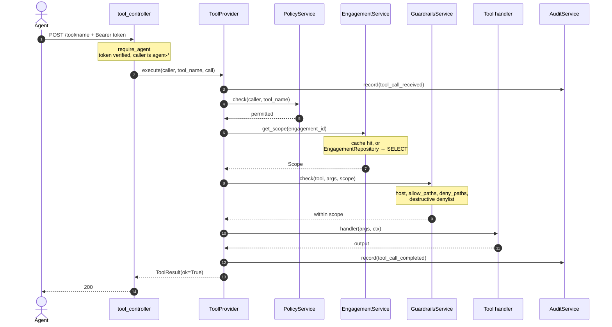
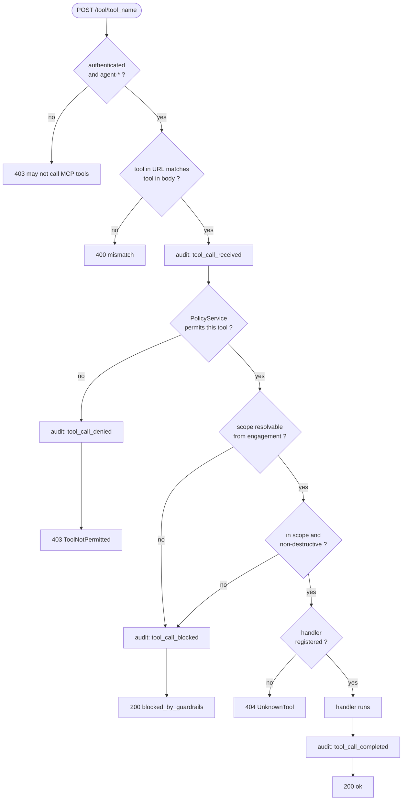

# Tool call flow — `mcp-tools`

How a request reaches a tool, and every way it can fail to.

Entry point is `call_tool` in [`mcp_tools/controllers/tool_controller.py`](../mcp_tools/controllers/tool_controller.py).

Four gates stand between an authenticated agent and a running tool, and the
order they are applied in *is* the security model:

1. **Authorise** — may this component call this tool at all?
2. **Resolve scope** — read the engagement's approved boundary from the store.
3. **Guardrails** — is this specific call in scope and non-destructive?
4. **Execute** — only now does a handler run.

Every one of those precedes any side effect. Putting authorisation ahead of
scope resolution also means an agent reaching for a tool it has no business
touching is refused without a database round trip.

---

## Successful invocation

---

## Every termination

| Termination                     | Response | Audit row written        |
| ------------------------------- | -------- | ------------------------ |
| Caller is not an agent          | 403      | none — before `execute()` |
| URL and body disagree           | 400      | none — before `execute()` |
| Tool outside agent's allowlist  | 403      | `tool_call_denied`       |
| Scope could not be resolved     | 200      | `tool_call_blocked`      |
| Out of scope, or destructive    | 200      | `tool_call_blocked`      |
| Permitted but unimplemented     | 404      | none — wiring fault      |
| Executed                        | 200      | `tool_call_completed`    |

A guardrails rejection returns **200**, not an error status. The call was
well-formed and properly authorised, and the agent is expected to read the
reason and adapt. Reserving 4xx for authorisation and wiring faults keeps that
distinction legible in both logs and agent code.

### Known gap

The first two terminations happen in the FastAPI dependency and the controller,
both before `ToolProvider.execute()` is reached, so neither leaves an audit row.
A component presenting a valid non-agent token and probing the tool surface is
refused correctly but silently. PRD §8 asks for an immutable record of *every*
agent action, which argues for auditing rejected calls at the controller
boundary too.

---

## Where each participant lives

| Layer           | Files                                                          | Role                                                            |
| --------------- | -------------------------------------------------------------- | --------------------------------------------------------------- |
| `controllers/`  | `tool_controller.py`, `dependencies.py` | Routing, authentication, status-code mapping. No business logic. |
| `providers/`    | `tool_provider.py` | Orchestration. Composes services and owns the order they run in. |
| `services/`     | `policy_service.py`, `guardrails_service.py`, `engagement_service.py`, `audit_service.py`, `tools/` | The individual decisions and units of work. |
| `repositories/` | `engagement_repository.py`, `audit_repository.py` | Every SQL statement this container issues, in one folder. |
| `utils/`        | `url.py`, `sanitise.py` | Pure helpers: URL extraction, host/path splitting, injection stripping. |

Each layer calls only the one below it: controller → provider → service →
repository. A controller never reaches past its provider — even for an
exception type — and a provider never issues SQL.

The decision services (`policy_service`, `guardrails_service`) touch no I/O at
all, which is what lets the security rules be tested without a database, an
HTTP client, or a running app — see
[`tests/test_tool_provider.py`](../tests/test_tool_provider.py), which
monkeypatches nothing.
